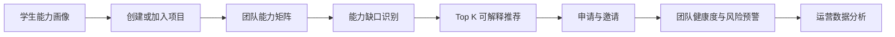

# CampusTeam

基于能力互补与多维画像的校园智能组队与项目协作平台。

CampusTeam 面向学科竞赛、课程项目、科研训练和创新创业活动。系统围绕“项目需要什么、团队缺少什么、谁最适合补齐缺口”建立业务闭环，提供学生能力画像、项目大厅、团队能力分析、能力缺口识别、可解释队友推荐、时间匹配、团队健康度与数据分析。

## 当前状态

P0、P1 主链路以及团队健康度、管理员统计、真实浏览器 E2E 和性能回归均已合并到 `main`。运行方法见 [本地交付说明](docs/local-handoff.md)，答辩步骤见 [演示脚本](docs/demo-script.md)，完整证据见 [答辩证据索引](docs/evidence-index.md)。

当前版本为 v1.0.0 课程交付候选版，提供 Django/DRF 后端、Vue 前端、Token 认证、角色权限、项目检索、团队申请/邀请、可解释推荐、健康度与风险预警、管理员统计、审计日志、演示数据和全链路自动化测试。

## 核心业务闭环



## 功能优先级

- P0：用户与权限、能力画像、项目大厅、项目需求、团队管理、申请/邀请、基础前后端。
- P1：团队能力矩阵、能力缺口识别、智能队友推荐、推荐解释、时间匹配。
- P2：团队健康度、风险预警、管理员数据分析中心。
- P3：一键候选团队、用户聚类、更复杂推荐模型、实时消息。

## 技术栈

- 前端：Vue 3、Element Plus、ECharts
- 后端：Python、Django、Django REST Framework
- 数据：MySQL、Pandas、NumPy
- 推荐：可解释加权评分，后续可引入 Scikit-learn
- 工程：GitHub Flow、Conventional Commits、GitHub Actions

## 推荐评分基线

`Score = 0.35 × 能力互补度 + 0.25 × 项目技能匹配度 + 0.20 × 时间匹配度 + 0.10 × 目标一致性 + 0.10 × 经历匹配度`

所有维度必须输出可解释的分项分数与推荐理由。权重调整必须记录 ADR，并用对比实验验证。

## 项目结构

```text
CampusTeam/
├── .github/                 Issue、PR 模板与 CI
├── campusteam/              Django 配置与根路由
├── core/                    用户、项目、团队、申请邀请与审计模块
├── docs/                    架构、API、ADR、会议与贡献证据
├── frontend/                Vue 3 前端（迭代一建立）
├── analytics/               推荐与数据分析模块（迭代二建立）
├── manage.py
├── requirements.txt
├── CONTRIBUTING.md
├── CHANGELOG.md
└── LICENSE
```

## 迭代计划

| 里程碑 | 目标 | 关键交付 |
|---|---|---|
| v0.1.0 Alpha | 立项、架构与 P0 骨架 | 需求、架构、ER/API、登录、CI、2 次会议记录 |
| v0.2.0 Beta | P0 闭环与 P1 算法 | 画像、项目、团队、申请邀请、缺口分析、推荐、覆盖率报告 |
| v1.0.0 | 完整演示与终期交付 | P0 100%、P1 ≥70%、健康度/看板、文档、贡献说明书、Release Notes |

## 团队角色

| 角色 | 核心职责 | 独立核心成果 |
|---|---|---|
| A Maintainer / Backend | 架构、Django、用户/项目/团队、权限、数据库、API、发布治理 | 可运行的后端业务系统与接口文档 |
| B Frontend / UX | 项目大厅、画像、团队、推荐、可视化、管理员看板 | 完整前端界面与可视化交互 |
| C Recommendation | 向量化、缺口计算、Top-K、评分与解释、算法实验 | 推荐算法模块与评价实验 |
| D Team Analytics / QA | 智能组队、健康度、风险、平台统计、测试与 CI | 团队分析模块、测试体系与数据分析报告 |

每人必须同时承担代码、测试、Review 和文档，不允许成员只写文档或只做零散页面。详细任务与满分证据见 [评分与协作执行方案](docs/project-rubric.md) 和 [GitHub Issue 待办清单](docs/issue-backlog.md)。

## 本地启动

需要 Python 3.11+。PowerShell 启动步骤：

```powershell
python -m venv .venv
.\.venv\Scripts\Activate.ps1
python -m pip install -r requirements.txt
Copy-Item .env.example .env
# 请将 .env 中 DJANGO_SECRET_KEY 改成本机随机值
python manage.py migrate
python manage.py seed_demo --leader-password '<本地密码>' --student-password '<本地密码>'
python manage.py runserver
```

访问 `http://127.0.0.1:8000/api/v1/health`，返回 `{"status":"ok"...}` 即启动成功。

运行测试及覆盖率：

```powershell
python -m coverage run manage.py test
python -m coverage report -m
```

## 已实现 API

- `GET /api/v1/health`
- `POST /api/v1/auth/register`、`POST /api/v1/auth/login`
- `GET/PATCH /api/v1/profiles/me`
- `GET/POST /api/v1/projects`、`GET/PATCH /api/v1/projects/{id}`
- `POST /api/v1/projects/{id}/applications`
- `POST /api/v1/applications/{id}/transition`
- `POST /api/v1/teams/{id}/invitations`
- `POST /api/v1/invitations/{id}/transition`
- `GET /api/v1/admin/audit-logs`

除健康检查、注册和登录外，其余接口使用 `Authorization: Token <token>`。错误格式统一为 `code/message/details`。

## 协作规则

所有工作必须遵循 `Issue → Branch → Commit → PR → Review → CI → Merge → Closed`。禁止直接向 `main` 推送，禁止自评自合，禁止补录或刷量。详见 [CONTRIBUTING.md](CONTRIBUTING.md)。

## 版本与证据

- Release Notes：[v0.1.0](docs/releases/v0.1.0.md)、[v0.2.0](docs/releases/v0.2.0.md)、[v1.0.0](docs/releases/v1.0.0.md)
- 答辩演示：[docs/demo-script.md](docs/demo-script.md)
- 测试与性能：[docs/coverage.md](docs/coverage.md)、[docs/performance-report.md](docs/performance-report.md)
- 贡献索引：[docs/contributions/README.md](docs/contributions/README.md)
- 发布证据自检：`python scripts/verify_release_evidence.py`

## 许可证

[MIT](LICENSE)
