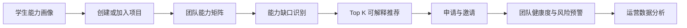

# CampusTeam

基于能力互补与多维画像的校园智能组队与项目协作平台。

CampusTeam 面向学科竞赛、课程项目、科研训练和创新创业活动。系统围绕“项目需要什么、团队缺少什么、谁最适合补齐缺口”建立业务闭环，提供学生能力画像、项目大厅、团队能力分析、能力缺口识别、可解释队友推荐、时间匹配、团队健康度与数据分析。

## 当前状态

项目处于立项与工程治理阶段。仓库已建立评分对照、Issue/PR 模板、CI 治理检查、架构草案、API 草案、ADR、会议记录模板和个人贡献说明书模板。

## 核心业务闭环



## 功能优先级

- P0：用户与权限、能力画像、项目大厅、项目需求、团队管理、申请/邀请、基础前后端。
- P1：团队能力矩阵、能力缺口识别、智能队友推荐、推荐解释、时间匹配。
- P2：团队健康度、风险预警、管理员数据分析中心。
- P3：一键候选团队、用户聚类、更复杂推荐模型、实时消息。

## 技术栈

- 前端：Vue 3、Element Plus、ECharts
- 后端：Python、Django、Django REST Framework
- 数据：MySQL、Pandas、NumPy
- 推荐：可解释加权评分，后续可引入 Scikit-learn
- 工程：GitHub Flow、Conventional Commits、GitHub Actions

## 推荐评分基线

`Score = 0.35 × 能力互补度 + 0.25 × 项目技能匹配度 + 0.20 × 时间匹配度 + 0.10 × 目标一致性 + 0.10 × 经历匹配度`

所有维度必须输出可解释的分项分数与推荐理由。权重调整必须记录 ADR，并用对比实验验证。

## 项目结构

```text
CampusTeam/
├── .github/                 Issue、PR 模板与 CI
├── docs/                    架构、API、ADR、会议与贡献证据
├── backend/                 Django/DRF 后端（迭代一建立）
├── frontend/                Vue 3 前端（迭代一建立）
├── analytics/               推荐与数据分析模块（迭代二建立）
├── tests/                   集成与端到端测试
├── CONTRIBUTING.md
├── CHANGELOG.md
└── LICENSE
```

## 迭代计划

| 里程碑 | 目标 | 关键交付 |
|---|---|---|
| v0.1.0 Alpha | 立项、架构与 P0 骨架 | 需求、架构、ER/API、登录、CI、2 次会议记录 |
| v0.2.0 Beta | P0 闭环与 P1 算法 | 画像、项目、团队、申请邀请、缺口分析、推荐、覆盖率报告 |
| v1.0.0 | 完整演示与终期交付 | P0 100%、P1 ≥70%、健康度/看板、文档、贡献说明书、Release Notes |

## 团队角色

| 角色 | 核心职责 | 独立核心成果 |
|---|---|---|
| A Maintainer / Backend | 架构、Django、用户/项目/团队、权限、数据库、API、发布治理 | 可运行的后端业务系统与接口文档 |
| B Frontend / UX | 项目大厅、画像、团队、推荐、可视化、管理员看板 | 完整前端界面与可视化交互 |
| C Recommendation | 向量化、缺口计算、Top-K、评分与解释、算法实验 | 推荐算法模块与评价实验 |
| D Team Analytics / QA | 智能组队、健康度、风险、平台统计、测试与 CI | 团队分析模块、测试体系与数据分析报告 |

每人必须同时承担代码、测试、Review 和文档，不允许成员只写文档或只做零散页面。详细任务与满分证据见 [评分与协作执行方案](docs/project-rubric.md) 和 [GitHub Issue 待办清单](docs/issue-backlog.md)。

## 本地启动

应用代码将在迭代一建立。届时必须提供 `.env.example`，并保证以下流程可复现：

```bash
cp .env.example .env
docker compose up -d db
cd backend && python -m pip install -r requirements.txt && python manage.py migrate && python manage.py runserver
cd frontend && npm ci && npm run dev
```

## 协作规则

所有工作必须遵循 `Issue → Branch → Commit → PR → Review → CI → Merge → Closed`。禁止直接向 `main` 推送，禁止自评自合，禁止补录或刷量。详见 [CONTRIBUTING.md](CONTRIBUTING.md)。

## 许可证

[MIT](LICENSE)
