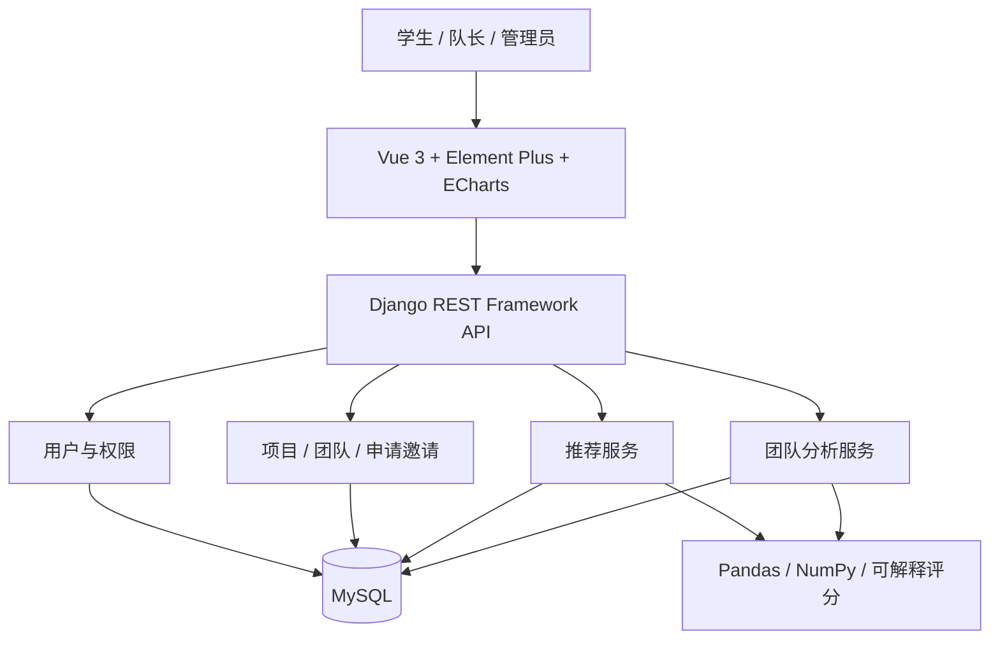
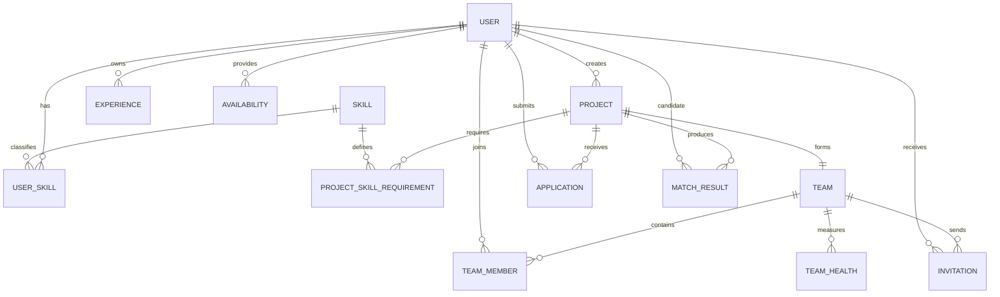

# CampusTeam 系统架构

## 架构目标

系统采用前后端分离与独立算法模块，保证 P0 业务可单独运行，同时使推荐和分析能力可独立测试、替换和解释。

## 分层职责

| 层 | 职责 | 技术 |
|---|---|---|
| 表现层 | 页面、交互、雷达图、推荐解释、管理看板 | Vue 3、Element Plus、ECharts |
| API 层 | 序列化、参数校验、认证、权限、错误码 | Django REST Framework |
| 业务层 | 用户、项目、团队、申请邀请与事务规则 | Django Service / Domain |
| 智能层 | 缺口、互补度、Top-K、健康度、风险 | NumPy、Pandas、自定义算法 |
| 数据层 | 业务实体、匹配结果、时间段、审计日志 | MySQL |

## 核心数据模型

## 非功能约束

- 不提交密钥；配置通过环境变量注入。
- 权限在后端强制校验，前端隐藏按钮不能替代授权。
- 推荐响应返回分项得分、实际权重、配置标识与解释文本；画像与需求持久化，请求时按当前成员重算。历史推荐快照尚未实现。
- 核心 Service/API 覆盖率下限 40%，团队目标 60%。
- 100、500、1000 候选人规模记录 Top-K 响应时间。
