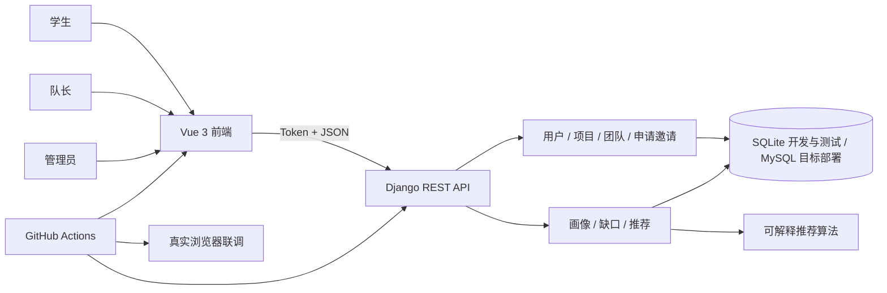
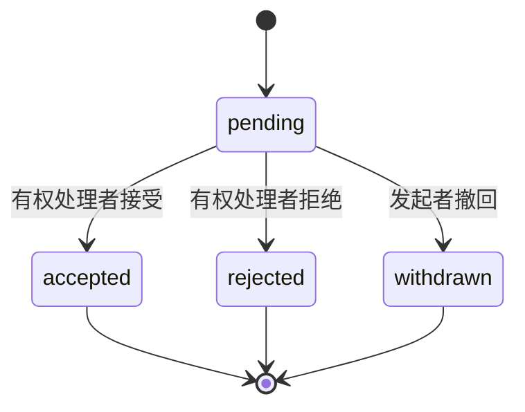

# #25 需求、架构与 API 设计评审（第一部分草案）

> 状态：Part A + Part B（第二部分由 yuuuu1693 完成，待两名非作者 Review）
>
> 第一部分负责人：`xxxioc-116`
>
> 第二部分协作人：`yuuuu1693`（ER 图细化、字段逐项核对、评审意见整改）
>
> 关联 Issue：#25；实现证据：PR #29、#30、#31、#32、#33

## 1. 评审目标与边界

本评审确认 CampusTeam 的需求范围、系统边界、模块职责、核心业务流程与 API 契约是否能够支撑课程项目验收。评审不重新实现已合并功能，也不把尚未交付的健康度、管理员统计或终期发布材料描述为已完成。

系统面向学生、队长和管理员三类业务角色。浏览器端只负责交互和可视化；身份认证、团队成员关系、邀请/申请状态迁移、管理员权限和推荐数据访问必须由服务端强制校验。演示 Mock 仅用于页面交互，不作为真实业务验收依据。

## 2. 需求基线与优先级

| 优先级 | 能力 | 当前验收状态 | 主要证据 |
|---|---|---|---|
| P0 | 注册、登录、Token 认证、业务角色 | 已实现 | #2、PR #29 |
| P0 | 项目创建、检索、分页与状态 | 已实现 | #4、PR #29；PR #30 |
| P0 | 申请、邀请、接受/拒绝/撤回 | 已实现 | #5、PR #29 |
| P0 | 个人能力画像持久化 | 已实现并完成真实联调 | #9；PR #30、#32、#33 |
| P1 | 团队能力矩阵与缺口 | 已实现并完成真实联调 | #11；PR #30、#32、#33 |
| P1 | 可解释 Top-K 推荐 | 已实现并完成真实联调 | #12–#18；PR #30–#33 |
| P1 | 时间重合度、目标一致性 | 待开发 | #20 |
| P2 | 健康度与风险预警 | 待开发 | #19、#21 |
| P2 | 管理员统计与分析报告 | 待开发 | #23 |
| P2 | 端到端与性能回归 | 部分完成，待 QA 总验收 | #24、PR #33 |
| 工程 | 主分支强制门禁 | 已配置并通过“无批准不可合并”验证 | #26、PR #33、验证 PR #35 |
| 发布 | Release、演示与答辩证据链 | 待完成 | #28 |

验收口径：功能必须同时具备实现、自动化测试、非作者 Review 和 CI 证据；仅有页面或 Mock 不视为业务闭环完成。

## 3. 系统上下文与边界

边界决定：

1. 前端隐藏按钮不能替代后端授权。
2. Django `is_staff` 不等于 CampusTeam 业务管理员；业务授权统一使用 `User.Role.ADMIN`。
3. 能力值公共契约为 0–100，算法内部归一化为 0–1。
4. 推荐请求按最新成员关系即时重算；当前不承诺历史推荐快照重放。
5. SQLite 用于课程演示和 CI；MySQL 是目标部署数据库，正式性能结论需单独验证。

## 4. 模块职责与依赖

| 模块 | 输入 | 输出 | 责任边界 |
|---|---|---|---|
| Auth | 用户名、密码、Token | 当前用户与业务角色 | 匿名仅可注册/登录；角色不可由画像接口修改 |
| Project | 项目信息、筛选参数 | 项目列表、团队入口 | 创建项目时自动建立团队并设置队长 |
| Membership | 申请/邀请及状态动作 | 成员关系、审计记录 | 状态迁移在事务内完成，重复待处理记录被拒绝 |
| Profile | 本人五维能力、标签、时间 | 持久化画像 | 用户只能修改本人画像 |
| Recommendation | 团队需求、成员画像、候选画像 | 矩阵、缺口、Top-K、解释与风险 | 团队成员可读；队长或业务管理员可配置需求 |
| Frontend | API 响应 | 页面、图表、错误与空态 | 不自行决定服务端权限，不把 Mock 当真实结果 |
| Quality Gate | 源码与锁文件 | lint/test/build/coverage/E2E 结果 | 任一上游失败时聚合门禁失败 |

## 5. 关键流程评审

### 5.1 创建项目与团队

1. 已登录用户提交项目。
2. 后端创建 `Project`、一对一 `Team` 和队长 `TeamMember`。
3. 项目所有者获得 leader 业务角色。
4. 任一步骤失败应回滚，不留下孤立团队或成员关系。

### 5.2 申请与邀请

同一申请人/项目或受邀人/团队只能存在一条待处理记录。接受前必须再次校验权限、团队容量和当前成员状态；接受后推荐矩阵从最新成员关系重新计算。

### 5.3 推荐闭环

画像保存 → 队长配置需求 → 团队矩阵 → 缺口 → Top-K 推荐 → 邀请 → 候选人接受 → 成员关系更新 → 矩阵和缺口重新计算。PR #33 已用非 Mock 浏览器与真实 Token 验证该流程。

## 6. API 契约评审基线

统一前缀 `/api/v1`，除健康检查、注册和登录外均使用 `Authorization: Token <token>`。错误响应统一为 `code/message/details`。

| 接口 | 请求重点 | 成功结果 | 权限与关键错误 |
|---|---|---|---|
| `POST /auth/register` | username/password/display_name | 新用户 | 匿名；角色固定为 student |
| `POST /auth/login` | username/password | token + user | 匿名；错误凭据 400 |
| `GET/PATCH /profiles/me` | 五维能力、技能、时间、目标、经历 | `{user, profile}` | 仅本人；非法能力/时间 400 |
| `GET/POST /projects` | keyword/type/status/page | 分页列表或新项目 | 已登录；非法枚举 400 |
| `POST /projects/{id}/applications` | message | pending 申请 | 团队成员不得申请自己的项目；重复 409 |
| `POST /applications/{id}/transition` | accept/reject/withdraw | 新状态 | 按发起者/负责人授权；非法迁移 400 |
| `POST /teams/{id}/invitations` | invitee_id/message | pending 邀请 | 队长或业务管理员；重复/已是成员 409 |
| `POST /invitations/{id}/transition` | accept/reject/withdraw | 新状态 | 按邀请人与受邀人授权 |
| `PATCH /teams/{id}/recommendation-requirements` | abilities/skills/time/weights | 持久化需求 | 队长或 `User.Role.ADMIN`；非法权重 400 且不覆盖旧值 |
| `GET /teams/{id}/capability-matrix` | team id | 当前/需求/成员矩阵 | 团队成员、队长或业务管理员 |
| `GET /teams/{id}/gaps` | team id | 正缺口列表 | 同上；未配置需求 400 |
| `GET /teams/{id}/recommendations` | top_k | 权重、分项、贡献、理由、风险 | 同上；top_k 0–1000 |
| `GET /admin/audit-logs` | page/page_size | 审计日志 | 仅 `User.Role.ADMIN` |

## 7. 非功能与质量门槛

- 安全：不提交真实口令、Token 或 `.env`；依赖安装禁用生命周期脚本；服务端强制授权。
- 正确性：Django migration drift 为零；算法输出贡献之和等于总分；稳定排序可复现。
- 测试：后端业务覆盖率不低于 80%，算法核心不低于 90%，前端关键纯逻辑设置覆盖率门槛。
- 性能：100/500/1000 候选人维持固定 SQL 次数；SQLite 数据仅作为基线，不冒充生产 SLA。
- 可追溯：Issue → Branch → Commit → PR → Review → CI → Merge → Closed。

## 8. 第一部分发现的待评审项

以下事项由第二部分继续核对并形成修改记录：

1. `docs/architecture.md` 的 ER 图包含尚未落库的 `EXPERIENCE`、`AVAILABILITY`、`MATCH_RESULT`、`TEAM_HEALTH`，应区分“当前模型”和“规划模型”。
2. `docs/api.md` 仍有 `is_staff` 可配置/读取推荐数据的旧表述，应统一为 `User.Role.ADMIN`。
3. `docs/api.md` 标题仍写“推荐模块本地已实现、待 PR 验收”，而 #31–#33 已合并，应更新状态。
4. README 的“当前本地集成分支”说明已过期；本 PR 已将其更新为当前 `main` 已合并状态。
5. 项目目标写 MySQL，但当前 CI 和演示主要使用 SQLite；需明确迁移与性能验收边界。

## 9. 第二部分协作清单（负责人 `yuuuu1693`）

- [x] 根据 Django 当前模型绘制“现状 ER 图”，另列规划实体，不混为已实现。
  （已完成：`docs/architecture.md` 拆分为“现状 ER”与“规划实体”两节，现状以
  `core/models.py` + `core/recommendation_models.py` 的 12 个落库模型为准；
  `EXPERIENCE`/`AVAILABILITY`/`MATCH_RESULT`/`TEAM_HEALTH` 明确标注为未落库。）
- [x] 逐项核对 `docs/api.md` 与实际 serializer/view/test，修正权限和状态描述。
  （已完成：两处 `is_staff` 表述更新为 `User.Role.ADMIN`，与 `core/recommendation_api.py`
  #57/#112 的实现一致；推荐模块状态标题更新为“已合并 main”。）
- [x] 补充至少两个请求/响应示例及 401/403/409 错误示例。
  （已完成：`docs/api.md` 已有画像与需求 PATCH、推荐响应示例；新增 401/403/409
  错误结构示例，并注明字段结构为准、文案以实现为准。）
- [x] 对本草案提出至少三条实质意见，并用后续提交体现修改。
  （意见见第 10 节评审记录首行；其中第 3 条即本次 architecture.md 拆分提交。）
- [ ] 邀请至少两名非作者 Review；逐条回复并解决对话。
  （**必须由同学本人在 GitHub 上完成**，AI 不得代为创建 Review。）
- [ ] CI 全绿后由 PR 自动关闭 #25，不直接手工关闭。

## 10. 评审记录

| 日期 | 评审人 | 意见 | 处理提交/结论 | 状态 |
|---|---|---|---|---|
| 2026-10-28 | `yuuuu1693` | ① `top_k` 后端允许 0–1000（`recommendation_api.py:146-151`），但前端页面只提供 3/5/10 档，契约文档也未说明超出档位的取值策略——建议在 api.md 标注“页面 UI 约束为 3/5/10，API 层允许 0–1000”，避免联调时误判。② 错误凭据登录返回 400 而非 401，本草案第 6 节与 `docs/api.md` 一致，但 `docs/frontend-api-contract.md` 旧契约仍写 401，需在联调时统一口径（前端 `client.js` 仅对 401 清会话，不受影响）。③ `architecture.md` 的 ER 图把 4 个未落库实体画成已有模型，误导评审——本次提交已拆分为现状/规划两节并加注说明。④ 建议为“接受申请时校验团队容量”补充并发用例：两个 accept 同时到达不应超员（`services.py` 事务内校验，缺自动化并发测试）。 | 本次提交同步修改 `architecture.md`、`api.md`，其余两条作为后续 Issue 候选 | 已处理 |

