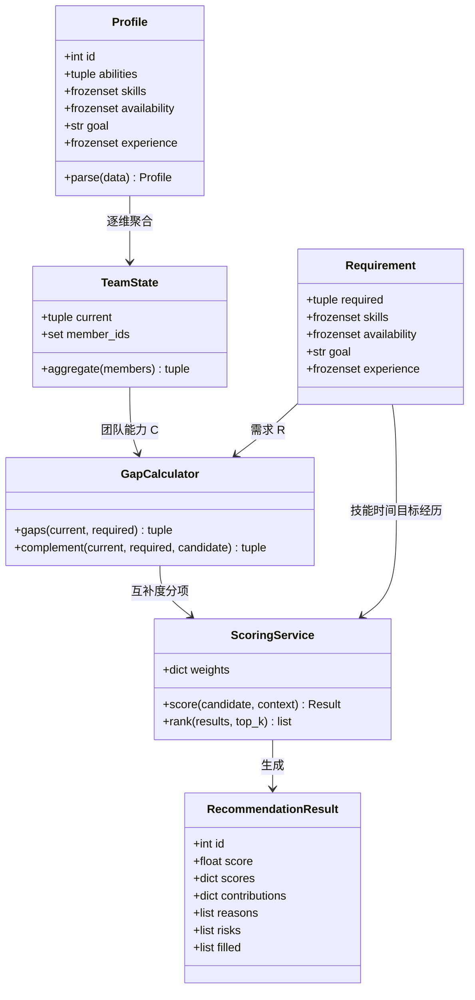
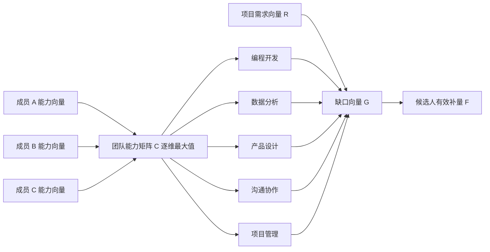
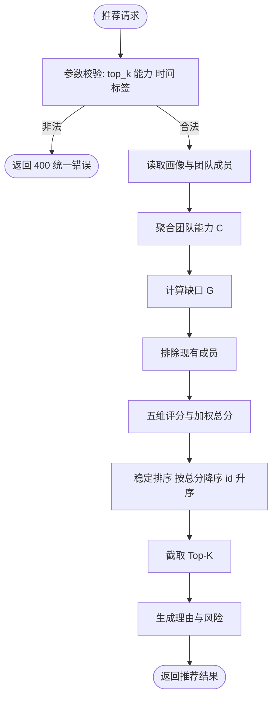
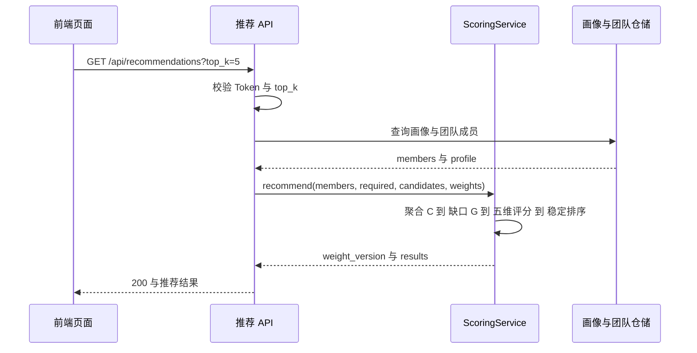

# 推荐算法设计图（Mermaid 源）

> GitHub 可直接渲染。报告阶段导出为 PNG 后放入 `docs/design/assets/recommendation/`，按 X-Y 编号，图题置于图下方，五号宋体加粗。

## 推荐模块类图



## 能力矩阵结构图



## 能力缺口计算流程图

```mermaid
flowchart TD
    A[输入 C R A] --> B[G(j) = max R(j) 减 C(j) 与 0 的较大值]
    B --> Q{缺口总和大于 0}
    Q -- 否 --> D[complement 记为 0]
    Q -- 是 --> E[F(p,j) = min G(j) 与 max A(p,j) 减 C(j)]
    E --> H[complement = 所有 F 之和 除以 所有 G 之和]
    D --> I[输出补量 F 与互补度]
    H --> I
```

## 推荐活动图



## 推荐查询时序图


